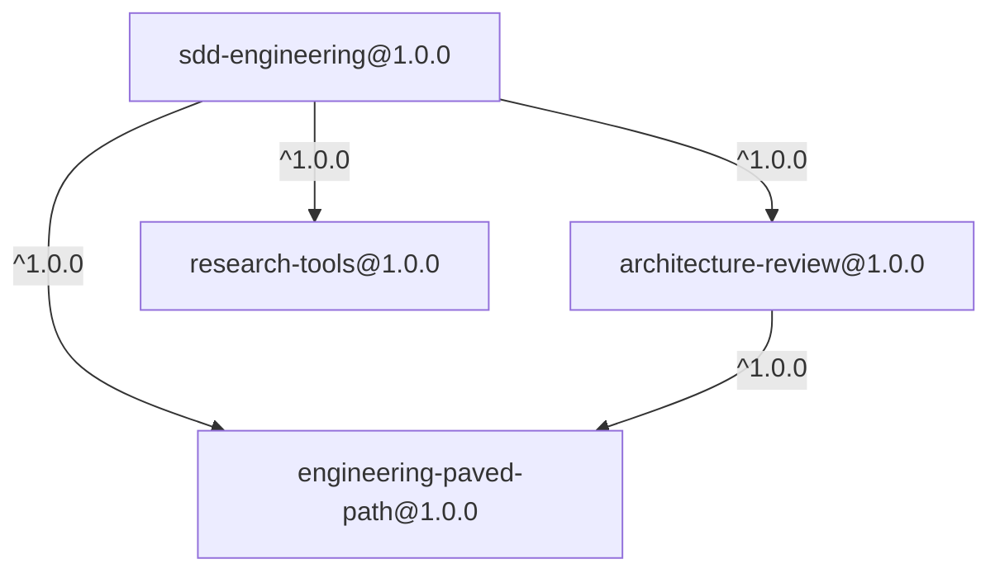
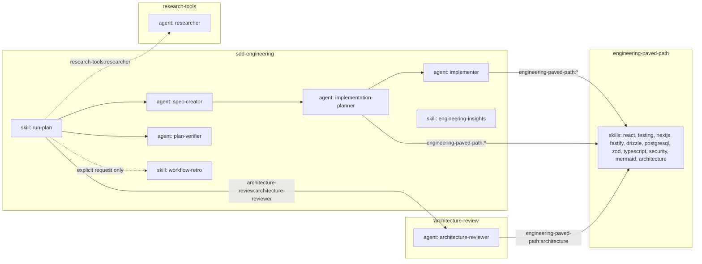

# Dependency Graph

## Plugin level

Declared in each plugin's `.claude-plugin/plugin.json` under `dependencies`.

`engineering-paved-path` is shared once: Claude Code resolves it a single time for both
`sdd-engineering` and `architecture-review`. There are no cycles.

## Component level

Dependency components are referenced by plugin-scoped (namespaced) name.

## Workflow order

1. `spec-creator` writes the spec.
2. `implementation-planner` reads the spec and writes the plan (may delegate questions to `research-tools:researcher`).
3. `run-plan` hands each task to `implementer`.
4. Independent review gate, run in parallel: `architecture-review:architecture-reviewer` and `plan-verifier`.
5. `workflow-retro` runs only when explicitly requested.

## Namespaced references

| Component | Reference |
|-----------|-----------|
| Shared skill | `engineering-paved-path:react-best-practices` |
| Researcher | `research-tools:researcher` |
| Architecture reviewer | `architecture-review:architecture-reviewer` |
| Own component | `sdd-engineering:spec-creator` |

## Release order

`engineering-paved-path` → `research-tools` → `architecture-review` → `sdd-engineering`
(dependencies first, consumer last — see [RELEASES.md](RELEASES.md)).

## Verification

After a test install, `claude plugin list --json` must show no `dependency-unsatisfied`,
`range-conflict` or `no-matching-tag` entries.
